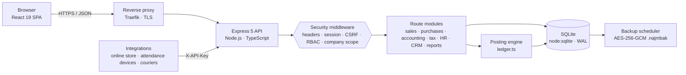
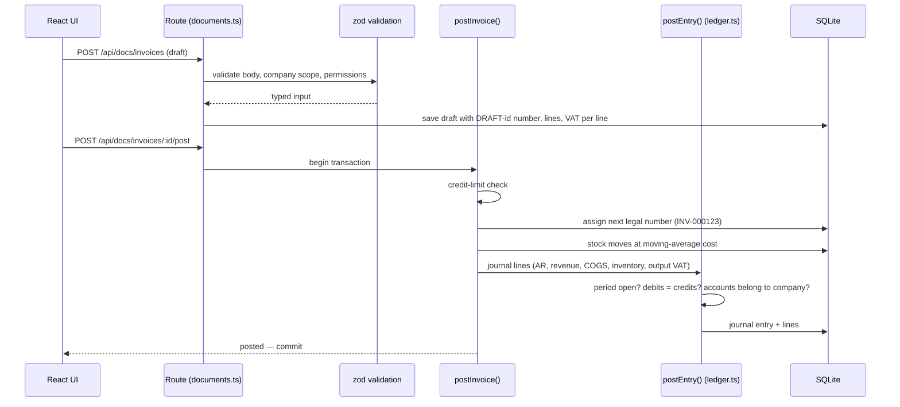

<div align="center">

# ⭐ Najm ERP

**A UAE-native business suite: accounting, VAT & Corporate Tax, inventory, CRM, projects, HR & payroll — in one app.**

*Najm (نجم) means “star” in Arabic.*


</div>

---

## Why Najm ERP

Small and medium businesses in the UAE carry a heavy compliance load — quarterly **VAT 201** returns, **Corporate Tax**, **WPS** salary files and **end-of-service gratuity** — yet most run on a patchwork of spreadsheets, a generic accounting package and a separate payroll sheet. Numbers get re-keyed several times and only meet at filing time.

Najm ERP puts the whole business in one double-entry system that already knows UAE rules. A sales invoice moves stock, posts cost of goods, records output VAT by emirate and updates the customer’s balance in a single transaction — so the VAT return, the ledger and the stock report always agree.

## Features

| Area | Highlights |
|---|---|
| **Sales** | Quotations → tax invoices → credit notes · bilingual (English/Arabic) FTA-style tax invoice with both TRNs, place of supply, per-line VAT, QR code and amount in words · credit-limit check · receipts with allocation and advances |
| **Purchases** | Bills, debit notes, supplier payments · reverse-charge VAT on imports |
| **Inventory** | Stock and service items · multi-warehouse · moving weighted-average costing · automatic COGS · transfers, counts and reorder alerts · barcode scanning (USB scanner or phone camera) |
| **Accounting** | Double-entry general ledger · manual and recurring journals · opening balances · departments (cost centres) · budgets · period lock |
| **PDC cheques** | Post-dated cheques received and issued: deposit, clear, bounce or cancel — each with its own ledger posting and due-date alerts |
| **Tax** | VAT 201 (boxes 1a–14, split by emirate) reconciled to the ledger · VAT period settlement · FTA Audit File (FAF) export · Corporate Tax (0%/9%, AED 375,000 threshold, non-deductible expenses, loss relief, Small Business Relief) |
| **CRM** | Lead pipeline and conversion · calls, visits and complaints · shipments with tracking timeline · full customer history |
| **Projects** | Projects tagged on invoices, bills and journals · timesheets · job costing (revenue, materials, labour, margin, budget use) |
| **HR & payroll** | Employee records with Emirates ID / visa / passport expiry alerts · attendance (manual, CSV, device push) · leave balances · payroll with pro-rata, unpaid leave and 125% overtime (rest breaks excluded) · gratuity per Decree-Law 33/2021 with monthly accrual · WPS SIF file · payslips · appraisals |
| **Reports** | P&L (by department), balance sheet, trial balance, general ledger, statements, AR/AP ageing, sales analysis, budget vs actual · live dashboard · CSV export and print/PDF |
| **Platform** | Several companies per install · roles and permissions · audit log · scoped API keys for integrations · encrypted automatic backups |

## Architecture



- **One process, no external services.** The API, the scheduler and the built React app are served by a single Node.js process. The database is SQLite through Node’s built-in `node:sqlite` — nothing else to install or operate.
- **Only two runtime dependencies:** `express` and `zod`. A small supply-chain surface for software that holds financial data.
- **Money is never a float.** Every amount is an integer in **fils** (AED × 100), rounded once at a defined point.

### The posting pipeline

Every financial event flows through one path, inside one database transaction:



1. **Draft** — validated with zod, VAT computed per line, saved with a temporary number.
2. **Post** — gets the next gap-free legal number, moves stock, and builds a journal entry.
3. **Ledger guardrails** — the engine refuses unbalanced entries, closed periods and accounts from another company.
4. **Immutable afterwards** — a posted document is never edited. Corrections are voids or credit notes that post **reversing entries**, so the audit trail stays complete.
5. **Reports read the ledger** — the trial balance, balance sheet, ageing and VAT return are all computed from the same journal lines, and the VAT return carries a ledger cross-check.

## Security

- **Passwords** hashed with scrypt; strength policy; 15-minute lockout after 5 failures (wrong passwords and wrong 2FA codes both count).
- **Two-factor authentication** (TOTP), with secrets encrypted at rest (AES-256-GCM).
- **Sessions** stored server-side (token hashes only) in `HttpOnly`, `SameSite=Strict`, `__Host-` `Secure` cookies; idle and absolute timeouts; rotated at login.
- **CSRF** token on every write, plus `Origin` / `Sec-Fetch-Site` checks.
- **Headers:** strict Content-Security-Policy, `X-Frame-Options: DENY`, `nosniff`, HSTS, `no-store` on API responses.
- **Role-based access** (admin, accountant, sales, purchasing, storekeeper, HR, viewer) enforced on the server.
- **Tenant isolation:** the company always comes from the session, never from the request — covered by an automated test.
- **Input handling:** all SQL parameterised; inputs validated with zod; CSV exports protected against formula injection.
- **First-run setup** protected by a one-time setup code in production.
- **Encrypted backups** (AES-256-GCM) on a timer, with verify and restore commands.

## Tech stack

| Layer | Choice |
|---|---|
| Runtime | Node.js 24+ (native TypeScript execution, `node:sqlite`, `node:test`) |
| API | Express 5, zod 4 |
| Database | SQLite (WAL mode, foreign keys on) |
| Front end | React 19, React Router 7, Vite |
| Deployment | Docker (multi-stage, non-root, read-only filesystem) behind Traefik with Let’s Encrypt |

## Getting started

```bash
git clone <this-repo> najm-erp && cd najm-erp
npm install
npm run build        # builds the React app into dist/
npm start            # http://127.0.0.1:3000
```

On first visit, create the system administrator and your first company. A UAE chart of accounts, a main warehouse and default departments are created automatically.

**Development with live reload:** `npm run dev` (API on :3000) together with `npm run dev:client` (UI on :5173, proxying `/api`).

**Windows:** double-click `start-najm-erp.bat` to install, build and open the app.

## Configuration

Create a settings file with strong random keys:

```bash
npm run setup-production   # writes najm.env (never commit it)
```

| Variable | Purpose |
|---|---|
| `NAJM_SECRET` | Encrypts two-factor secrets. Required in production. |
| `NAJM_BACKUP_KEY` | Encrypts backups. **Without it, encrypted backups cannot be opened — store it safely.** |
| `NAJM_SETUP_CODE` | One-time code required to create the first administrator in production. |
| `NODE_ENV`, `HOST`, `PORT` | `production` enables Secure cookies and HSTS. |
| `NAJM_TRUST_PROXY` | `1` when running behind a reverse proxy. |
| `NAJM_TLS_CERT` / `NAJM_TLS_KEY` / `NAJM_TLS_PFX` | Built-in HTTPS without a proxy. |
| `NAJM_DATA_DIR`, `NAJM_BACKUP_DIR` | Where the database and backups live. |
| `NAJM_BACKUP_HOURS`, `NAJM_BACKUP_KEEP` | Backup frequency (default 24 h) and how many to keep (default 30). |
| `NAJM_IDLE_TIMEOUT` | Session idle timeout in seconds. |
| `NAJM_BREAK_MINUTES` | Unpaid rest break deducted on shifts over 5 hours (default 60). |

## Deployment (Docker + Traefik)

```bash
# On the server, in the app folder, with najm.env next to it:
echo "NAJM_DOMAIN=erp.example.com" > deploy/.env
cd deploy && docker compose up -d --build
```

The container runs as a non-root user on a read-only filesystem with all Linux capabilities dropped and no published ports — only Traefik reaches it. Data and backups are mounted volumes. Several separate installs can share one server by setting `COMPOSE_PROJECT_NAME` in each one’s `deploy/.env`.

## Backups and restore

```bash
npm run verify-backup -- path/to/backup.najmbak   # checks it decrypts and is intact
npm run restore       -- path/to/backup.najmbak   # stop the app first; keeps the old DB aside
```

Backups are consistent SQLite snapshots, encrypted when `NAJM_BACKUP_KEY` is set. Copy them off the server and test a restore regularly.

## Integration API

Create a key in **Settings → API keys** and send it as `X-API-Key`. Keys are hashed and scoped.

```
POST /api/v1/orders              orders:write       online order → customer, posted invoice, payment, shipment (idempotent)
POST /api/v1/attendance/punches  attendance:write   punches from attendance devices
POST /api/v1/shipments/events    shipments:write    courier status updates
GET  /api/v1/items               items:read         catalogue, prices and stock
```

Amounts in the API are integer **fils**.

## Testing

```bash
npm test            # 24 end-to-end tests against a fresh database
npm run typecheck   # strict TypeScript, server and client
```

The suite covers posting and stock, VAT 201 and the FAF export, PDC lifecycle, trial balance and balance sheet, period locks, recurring journals, payroll, gratuity and Corporate Tax, plus security: CSRF, security headers, RBAC, tenant isolation, account-takeover protection, login and 2FA lockout, and encrypted backups.

## Project structure

```
server/
  index.ts          app setup, middleware order, static hosting
  security.ts       sessions, CSRF, headers, passwords, 2FA, RBAC
  db.ts             schema and migrations (node:sqlite)
  ledger.ts         double-entry posting engine and stock valuation
  backup.ts         encrypted backup scheduler
  routes/           auth · admin · masters · documents · accounting · reports · ops · hr · integrations
client/src/
  pages/            one module per area (Sales, Accounting, Tax, HR, …)
  ui.tsx, api.ts    shared components and API client
tests/              end-to-end API tests (node:test)
deploy/             Docker Compose for Traefik hosting
scripts/najm.ts     setup-production · verify-backup · restore
```

## Roadmap

- [ ] Self-service sign-up and subscription billing
- [ ] Excel/CSV import for customers, suppliers, items, employees and opening balances
- [ ] UAE e-invoicing (PINT AE) through an accredited service provider
- [ ] Owner dashboard for managing many customer accounts

## Disclaimer

VAT, Corporate Tax, WPS and labour-law calculations follow published UAE rules as of 2026. Have a qualified tax agent review figures before filing. Najm ERP is an independent product and is not affiliated with any other ERP vendor.

## License

© 2026 NexAura. All rights reserved.
